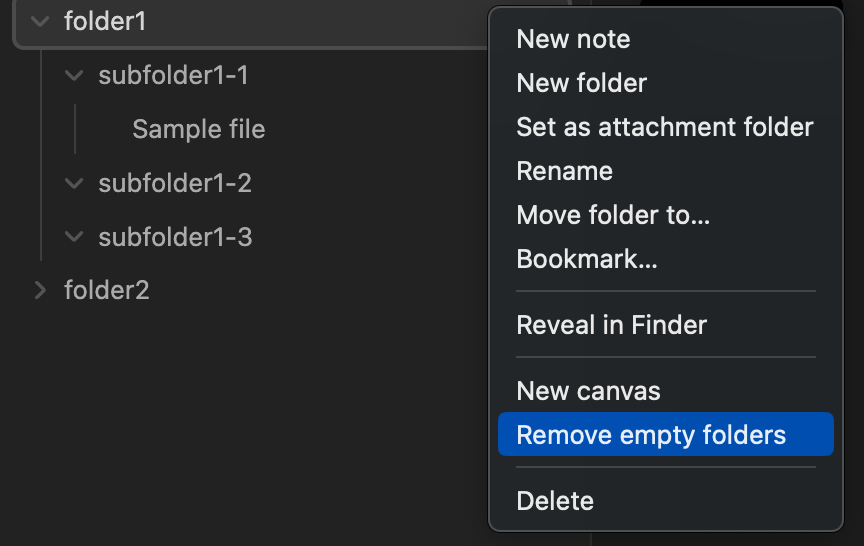

# Remove Empty Folders

This is an Obsidian plugin that removes empty folders.

## Caution !!

**Be sure to back up Obisidan data before running this plugin !!**

**In the worst case scenario, data may be lost.**

## How to use

### From File Explorer:
Select the folder(s) in the File Explorer from which you want to remove the empty folder(s).

Right click on the selection and select `Remove empty folders`.

In the image example, `subfulder1-2` and `subfulder1-3` will be removed.

### From Command Palette:
Open the Command Palette (`Ctrl/Cmd + P`) and select `Remove all empty folders in vault` to clean up all empty folders across the vault.

## Troubleshootings

In the unlikely event that an unexpected folder is deleted, please check inside the `ObsidianValtPath/.trash` folder.

The plugin moves the empty folder to the obsidian `.trash` folder rather than physically removing it, so the contents can be checked and recovered as shown in the following image.

